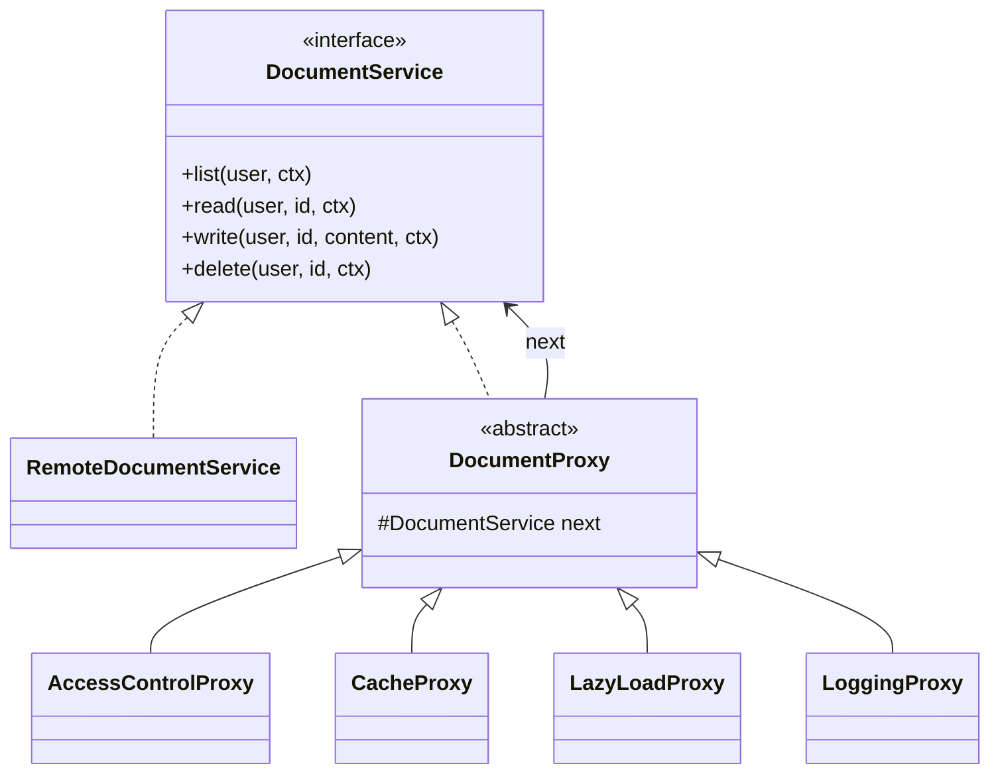

# proxy_backend — BóvedaDocs (Patrón Proxy)

Backend en **Java 11 puro** (sin Maven, sin dependencias) para el laboratorio del patrón **Proxy**. Expone una API REST con `com.sun.net.httpserver` sobre un gestor documental ficticio.

> Repositorio hermano: [proxy_frontend-](https://github.com/nicomora70/proxy_frontend-)

## 1. El caso

**BóvedaDocs** es una bóveda documental empresarial. Cuatro usuarios con roles y áreas distintas consultan, editan y borran documentos clasificados como `PUBLIC`, `INTERNAL` o `CONFIDENTIAL`.

| Usuario | Rol | Área |
|---|---|---|
| Laura Gómez | `VIEWER` | Legal |
| Andrés Rojas | `EDITOR` | Legal |
| Sofía Pérez | `EDITOR` | RRHH |
| Carlos Ruiz | `ADMIN` | Dirección |

Reglas:

- `PUBLIC`: todos leen.
- `INTERNAL`: misma área o `ADMIN`.
- `CONFIDENTIAL`: `ADMIN` o dueño.
- Escribir: `ADMIN`, o `EDITOR` de la misma área; confidencial solo dueño/`ADMIN`.
- Borrar: solo `ADMIN`.
- El listado devuelve metadatos. El contenido pesa ~1,5 MB y tarda **1,2 s** simulado.

## 2. Por qué Proxy

El cliente solo conoce `DocumentService`. No sabe si detrás está el servicio real o una cadena de proxies. Cada capa agrega una responsabilidad transversal sin tocar el servicio real ni el cliente:

| Rol del patrón | Clase |
|---|---|
| **Subject** | `service/DocumentService` |
| **RealSubject** | `service/RemoteDocumentService` |
| **Proxy abstracto** | `proxy/DocumentProxy` |
| **Protection proxy** | `proxy/AccessControlProxy` |
| **Cache proxy** | `proxy/CacheProxy` |
| **Virtual proxy** | `proxy/LazyLoadProxy` |
| **Logging proxy** | `proxy/LoggingProxy` |

Cadena por defecto (de afuera hacia adentro):

```
LoggingProxy → AccessControlProxy → CacheProxy → LazyLoadProxy → RemoteDocumentService
```



**Proxy vs Decorator:** Decorator agrega comportamiento y el cliente decide las capas; Proxy controla el acceso al sujeto y suele ser transparente para el cliente. Aquí la cadena se construye en el servidor según `layers`, no en el frontend.

## 3. API

Base: `http://localhost:8080/api`

| Método | Ruta | Descripción |
|---|---|---|
| GET | `/health` | Estado del servicio |
| GET | `/users` | Usuarios y roles |
| GET | `/documents?userId=u1&layers=log,access,cache,lazy` | Listado filtrado por el proxy de acceso |
| GET | `/documents/{id}?userId=u1&layers=...` | Contenido (cache/lazy) |
| PUT | `/documents/{id}?userId=u1&layers=...` | Editar `{"content":"..."}` |
| DELETE | `/documents/{id}?userId=u1&layers=...` | Borrar |
| GET | `/audit` | Últimas 60 entradas |
| POST | `/reset` | Reinicia documentos, caché y auditoría |

Cada respuesta incluye `latencyMs` y `trace`; las lecturas agregan `cacheHit` y `lazyReused`. Los errores devuelven `{"error", "code", "trace"}`.

## 4. Ejecutar

### Local (JDK 11+)

```powershell
Get-ChildItem -Recurse -Filter *.java src,test | ForEach-Object { $_.FullName.Substring((Get-Location).Path.Length + 1) } > sources.txt
javac --release 11 -encoding UTF-8 -d out "@sources.txt"
java -cp out com.bovedadocs.ProxySmokeTest
java -cp out com.bovedadocs.Main
```

### Docker

```bash
docker compose up --build -d
curl http://localhost:8080/api/health
```

La imagen es multi-stage, corre como usuario `app` y tiene `HEALTHCHECK`.

## 5. Guion de demo

1. `GET /documents?userId=u1` → Laura ve 3 de 8 documentos.
2. `GET /documents/d2?userId=u1` → **403** y entrada `DENIED` en auditoría.
3. `GET /documents/d1?userId=u2` dos veces → 1204 ms y luego **0 ms** con `cacheHit`.
4. Quitar `access` de `layers` → Laura puede leer/borrar lo que antes estaba prohibido.
5. Quitar `cache` → las segundas lecturas vuelven a tardar.
6. Quitar `log` → la auditoría deja de registrar.
7. `POST /reset` para reiniciar la demo.

## 6. Flujo de ramas

Ver [task.md](task.md). Ramas: `chore/scaffold`, `feat/domain-proxies`, `feat/api-tests`, `build/docker`, `docs/final`, integradas a `main` con `--no-ff`.
